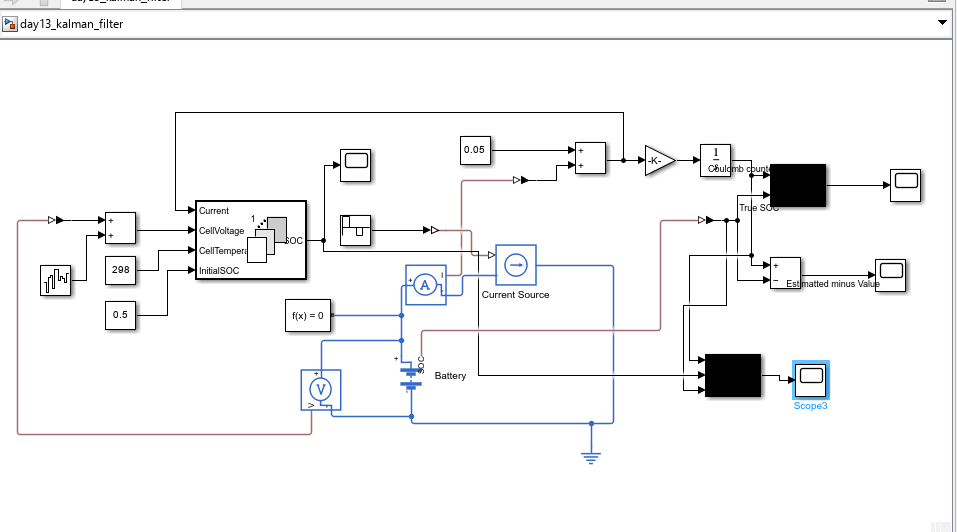
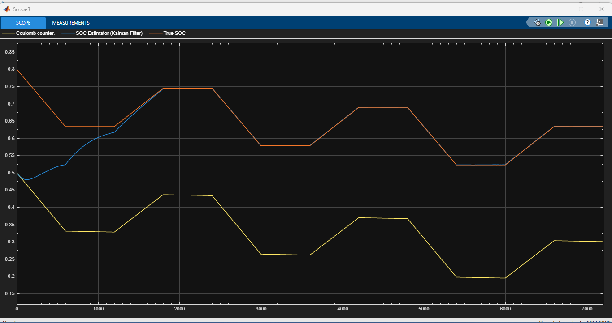
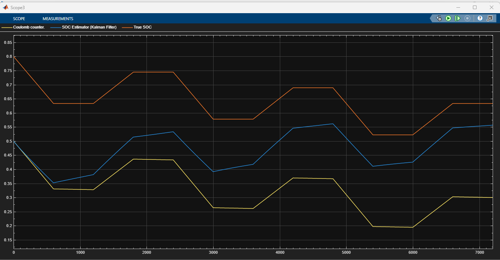

# Battery SOC Estimation: Kalman Filter vs Coulomb Counting (Simulink / Simscape)

  

**Two SOC estimators start from the same wrong value and see the same biased current sensor. Coulomb counting stays wrong; the Kalman filter finds its way back using the voltage.**

Part of my 30-day self-study series on battery management systems (BMS). Author: Ali Sher, M.Sc. Hybrid Electric Propulsion Technology, BTU Cottbus-Senftenberg.

---

## TL;DR
| Estimator | Starts at | Final error at 7200 s | Why |
|---|---|---|---|
| Coulomb counting | 0.50 (true 0.80) | about **-0.33** | only integrates current: a wrong start is never corrected, and the 0.05 A sensor offset adds drift |
| Extended Kalman filter, Q = 1e-6 | 0.50 | about **0** (locked on after roughly 1800 s) | compares the predicted voltage with the measured voltage and corrects the SOC |
| Extended Kalman filter, Q = 1e-8 | 0.50 | about **-0.08** | trusts its own counting too much, so it corrects slowly |

The values are read from the scope plots below, so they are approximate.

---

## What is being tested
The true cell is a Battery (Table-Based) block with a one-RC-pair dynamic model. Both estimators see only **measured** signals:
- **Current:** the true current plus a **+0.05 A offset**
- **Voltage:** the true terminal voltage plus **about 5 mV of Gaussian noise** (noise power 2.5e-5, sample time 1 s)
- **Temperature:** a constant 25 degC (298.15 K)
- **Initial SOC guess:** 0.50, while the true initial SOC is 0.80

The load is the same synthetic profile as in my Coulomb counting project: +3 A for 600 s, rest 600 s, -2 A for 600 s, rest 600 s, repeated for 7200 s. The true SOC ends at 0.633.

## Estimators
**Coulomb counting.** SOC = SOC0 - (1/Q) x integral of I dt, with Q = 3 Ah.

**Kalman filter.** The SOC Estimator (Kalman Filter) block from Simscape Battery (Simscape / Battery / BMS / Estimators), with the filter type set to Extended Kalman filter and one time-constant dynamics (states: SOC and the RC voltage V1). It predicts with the same counting, then corrects the state with the difference between the measured and the predicted voltage.

| Setting | Value |
|---|---|
| Sample time | 1 s |
| Cell model | R0 = 20 mOhm, R1 = 15 mOhm, tau1 = 30 s, 3 Ah, OCV 3.0 V (0 %) to 4.2 V (100 %) |
| Measurement noise covariance R | 2.5e-5 |
| Initial state covariance P0 | diag(0.1, 1e-4): the filter knows its start value is uncertain |
| Process noise covariance Q | diag(1e-6, 1e-6) (main run) or diag(1e-8, 1e-6) (comparison) |

---

## Results

### Q = 1e-6: the filter locks on
The Kalman estimate (blue) rises from the wrong start toward the true SOC (orange) and lies on top of it from about 1800 s. The Coulomb counter (yellow) stays about 0.30 to 0.33 too low for the whole run.

### Q = 1e-8: trusting the model too much
With a much smaller process noise, the filter believes its own (wrong) starting count and listens less to the voltage. It moves the right way but is still about 0.08 off at the end. It is much better than Coulomb counting, but clearly slower than the Q = 1e-6 run.

---

## What this shows
1. **Voltage is a second source of information about SOC.** A Kalman filter uses it to remove errors that Coulomb counting can never remove: a wrong start and a current sensor offset.
2. **Q is a trust setting.** A larger Q means more trust in the voltage and faster convergence, but a noisier estimate. A smaller Q means smoother but slower.
3. **P0 matters.** With the default, tiny initial covariance, the filter is nearly certain about its start value and barely reacts to the voltage. Setting it large lets the first measurements pull the estimate.
4. **Convergence takes time.** The filter needed roughly 1800 s here, because during the first discharge phase the counting pushes the estimate down while the voltage pulls it up.
5. **Current sign convention is a trap.** My first run had the current sign reversed on the estimator input. The estimate moved opposite to the true SOC, and a larger Q partly hid it. A sign check on every input is the first debugging step.

## Where this is used
Kalman-filter-based observers, usually combined with Coulomb counting, are the standard SOC estimators in EV and storage BMSs.

---

## How to run
1. Open `day13_kalman_filter.slx` in MATLAB (Simulink, Simscape, Simscape Electrical, Simscape Battery; the SOC Estimator block needs R2022b or later).
2. Set the stop time to 7200 s and run.
3. To reproduce the comparison, change Q(1,1) in the estimator's Main tab between 1e-6 and 1e-8.

## Limitations (honest version)
- The true cell uses the same one-RC structure as the filter's internal model, which favors the filter. A real cell has more complex dynamics, temperature dependence and aging.
- Constant temperature, Gaussian voltage noise, synthetic load profile, no measured data.
- The estimator's cell capacity equals the true capacity. A capacity error (aging) would degrade it.
- The OCV curve is fairly steep in this model. Chemistries with a flat OCV region give the filter less to work with.

## Roadmap
- [ ] Capacity error and aging: how much does the filter degrade?
- [ ] Compare the extended and the unscented Kalman filter
- [ ] Run on a standard drive cycle, and later on measured data
- [ ] Write my own EKF in a MATLAB Function block and compare with the Simscape block

---

## More from this series
| Project | Topic |
|---|---|
| [coulomb-counting-soc-estimation](https://github.com/alisherbtu/coulomb-counting-soc-estimation) | Coulomb counting and how three faults make it drift |
| [active-cell-balancing](https://github.com/alisherbtu/active-cell-balancing) | charge-transfer balancing and controller stability |
| [passive-cell-balancing](https://github.com/alisherbtu/passive-cell-balancing) | bleed-resistor balancing of a 4S pack |
| [battery-charge-discharge-circuit](https://github.com/alisherbtu/battery-charge-discharge-circuit) | charging and discharging a cell through a simple circuit |
| [hybrid-cell-battery-model](https://github.com/alisherbtu/hybrid-cell-battery-model) | energy cell and power cell sharing a load |
| [battery-pack-grid](https://github.com/alisherbtu/battery-pack-grid) | 10.8 kWh grid-connected pack driven by a power command |

*Learning project: all results come from the simulation model described above, not from lab measurements.*
